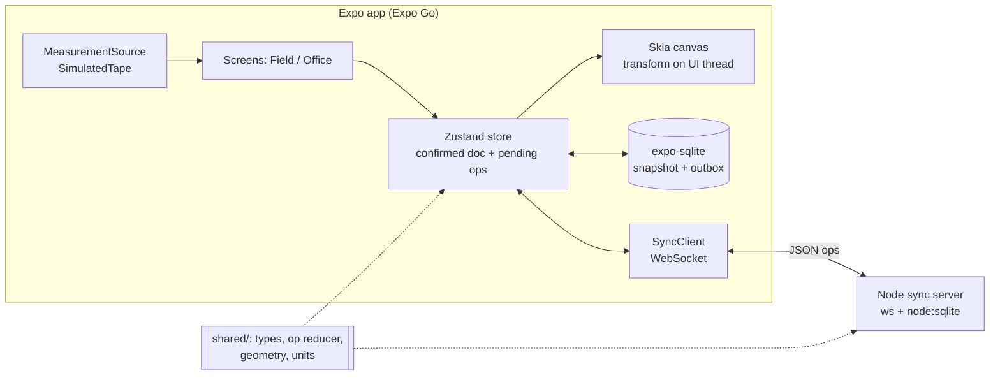
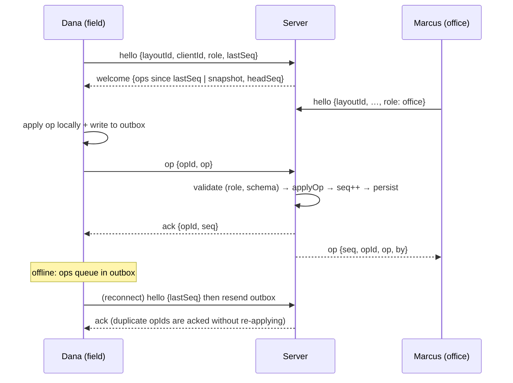

# Field Form — Design

> Working design doc. It is the source for the one-page `NOTES.md` deliverable.
> Status: draft v2 (2026-11-23). Read this before writing code; update it when a decision changes.

## 1. Problem in one sentence

Dana measures a space with gloves on, in sun or rain, and produces a dimensioned layout. Marcus watches it arrive in the office and trusts it enough to quote from it.

## 2. Assumptions

These are the assumptions sent to Josh on 2026-11-23. Revisit them if he answers.

| # | Assumption | Consequence |
|---|---|---|
| A1 | Sync is one-to-one (Dana → Marcus) first. The protocol does not prevent N clients. | Server broadcasts to every subscriber of a layout. Conflicts resolve last-writer-wins per field by server order. |
| A2 | Dana can work offline. Her edits sync when she reconnects. | Local op outbox, persisted on the device, replayed idempotently. |
| A3 | Marcus views and inspects but **cannot change geometry**. Both Dana and Marcus can comment (a stretch goal). | The server rejects geometry ops from the `office` role. The field is the single source of truth. Comments are a separate op type that never touches geometry. |
| A4 | Reviewers may use physical devices or emulators. | The sync host is detected automatically from Expo's `hostUri`, with a manual override. |
| A5 | Layouts are 2D. Heights (sill height, step rise) are dimensions *on* 2D elements, not 3D geometry. | No 3D engine. |
| A6 | One outline per layout. A fence is an open outline; a room, deck or patio is closed. | Islands and multiple outlines are cut (see §10). |
| A7 | Imperial is the default (feet-inches, fractions to 1/16"). Metric is a display toggle. | Values are stored in canonical integer µm, so changing units never changes data. |
| A8 | No auth. Role (field/office) and a display name are chosen at app launch. | Auth goes in "next week". |
| A9 | Dana may use a phone **or a tablet**; Marcus uses an iPad. | Both screens are responsive: the field screen keeps its bottom action bar on a phone and gains a side panel on a tablet. |
| A10 | Reviewers will likely run on iOS (iPad or Simulator), but development and testing happen on Android only. | Use only packages that support both platforms; list iOS as untested in `NOTES.md`. |

## 3. Platform constraints (verified)

- **Expo SDK 58** (React Native 0.88). Expo Go 58.0.5 on the App Store added SDK 58 support on 2026-10-22 and supports only SDK 58. Scaffold with `npx create-expo-app --template default@sdk-58`. Install every native-backed package with `npx expo install` so its version matches what Expo Go bundles.
- **No native Bluetooth in Expo Go.** `react-native-ble-plx` needs a development build. Measurement input therefore goes through a `MeasurementSource` interface, with a simulated tape implementation (§6).
- **No backend-as-a-service.** We provide our own Node server that runs with `npm run dev`. A Dockerfile is offered as an alternative.
- **Development is on Windows**, so there is no iOS Simulator. We test on Android emulators: a phone (Dana) and a tablet (Marcus, standing in for the iPad).

## 4. Interaction design

### 4.1 Core idea: draw it, then measure it

The brief says Dana should "attach measurements to **what she's drawn**", so the primary flow is **sketch, then measure** (Mode A). A second, faster flow (**walk the perimeter**, Mode B) is a shortcut for simple rectangles and fence runs. She can mix the two on the same layout, because both produce the same data: an ordered list of walls. If time runs short, Mode B is cut, never Mode A.

**Mode A (primary): Sketch, then measure**

```
Tap corner → tap corner → tap corner → … → tap the first corner to close
→ each wall shows "~8'" (a sketch estimate) → measure walls one by one
```

- She **taps corners**; there is no freehand dragging. Each tap snaps to **angles of 15° and lengths of 6"**, so a gloved, imprecise tap still makes a clean, square shape. A large magnifier above her finger shows where the corner will land.
- Sketched walls are drawn **dashed and labelled with "~"**. When a real reading arrives for a wall, it becomes solid and the shape **re-flows to the true length**. The drawing never keeps proportions that contradict its labels.
- When she finishes the sketch, the armed slot (§4.3) moves to wall 1, so measuring the rest is just tape presses.

**Mode B (shortcut): Walk the perimeter** (fastest for rectangular rooms, decks and fence runs)

```
Start corner → [reading 12' 4-3/8"] → wall 1 placed →
turn ↰ 90° (default) → [reading 9' 0"] → wall 2 placed → … → Close
```

- Each reading **becomes** the next wall. Turns are big buttons: **↰ Left 90**, **↱ Right 90**, **↑ Straight**, and **∠ Other** (an angle keypad for 45° bays). Left 90 is the default, so a rectangular room needs no turn taps.

**Shared by both modes**

- The outline is stored as **walls `{turn, length: measured ?? sketched}`**, and corner positions are derived from them (turtle geometry). Editing wall 3's length moves every later corner automatically. A sketch is the same walls with only estimated lengths.
- **Closing a shape** computes the closing wall. If Dana also measures it, the app shows the **closure error** (computed vs. measured) in green, amber or red. A misread tape is caught *on site*, before Marcus quotes from bad numbers.
- A **fence** is an open outline and skips the closure step.
- Dragging a corner is available for corrections, but no step of the core flow requires it.

**Rejected alternative:** freehand finger strokes simplified into lines. With gloves the strokes are too wobbly, and simplifying them (Ramer–Douglas–Peucker plus snapping) guesses at corners Dana didn't mean. Tapping corners gives the same "draw it" feel with predictable results.

### 4.2 Features attach to walls

| Feature | Anchored to | Dimension slots |
|---|---|---|
| Door | wall | offset from wall start, width, *(height)* |
| Window | wall | offset, width, *(sill height, height)* |
| Opening | wall | offset, width |
| Step / stairs | wall | offset, width, rise, run, count |
| Post | interior | x and y offsets from a chosen corner, size (caliper) |

Slots in *(italics)* are optional. Dana selects a wall, taps a feature type, and the app **arms the first empty slot**. Posts are placed by tapping inside the outline; the tap is a sketch position until the offsets are measured, exactly like sketched walls.

**Detail slots (calipers).** Some slots are marked as *detail* dimensions: post size, door jamb depth, trim thickness. When a detail slot is armed, the app expects the caliper and displays the value in mm or to 1/32". Long slots expect the tape. Any source can fill any slot; the hint only picks the default device and display precision.

### 4.3 Measurement capture: "armed slot", then auto-advance

- Exactly one dimension slot is **armed** at a time. It is highlighted with a thick yellow border.
- A tape reading fills the armed slot, triggers a haptic tick, and **auto-advances** to the next empty slot. Dana can measure a whole door (offset, then width) with no screen taps, only tape-button presses. This mirrors how BOLDR forms auto-fill.
- **Manual entry** uses a full-screen numeric keypad with large keys plus `ft`, `in` and fraction keys (`1/2`, `1/4`, `1/8`, `1/16`). It parses free-form text such as `12' 4-3/8"` or `3760 mm`. Use it for numbers read off a plan or called out by a teammate.
- Every value records its **provenance**: `source: tape | caliper | manual`, device name, time, and who captured it. Marcus can see which numbers were typed in rather than measured.
- An empty slot shows "—", and the layout shows **"3 dimensions missing"**. That doubles as Dana's to-do list and Marcus's "not ready to quote" signal.

### 4.4 Built for gloves, sun, rain and dust

| Condition | Design response |
|---|---|
| Gloves | Touch targets of at least 64 dp. Primary actions sit in a bottom action bar (thumb reach). The core flow (taps and tape presses) needs no drag, long-press or pinch. Sketch taps snap to 15° and 6", with a magnifier above the finger. Hit-testing for selection uses a 32 dp screen-space radius. |
| Bright sun | High-contrast theme: near-black on white, with REEKON yellow only for the armed/active state. Large numerals (≥ 28 sp). No meaning carried by thin lines or low-contrast greys. Measured walls are solid lines; unmeasured walls are dashed *and* labelled, never colour alone. |
| Rain (ghost touches on a wet screen) | Destructive actions need confirmation. One big **Undo** is always visible. Repeated taps on the same control are debounced. |
| 3–5 spaces a day | Creating a layout takes one tap: pick Room, Deck, Patio or Fence, and the name is generated (e.g. "Deck · Nov 23, 2:40 PM"), renamable later. Fence pre-selects an open outline. |
| Phone or tablet | The same field screen adapts: phone keeps everything in the bottom action bar; tablet moves the dimension list to a side panel. Touch-target sizes stay the same. |
| Interruptions and no signal | Every op is saved locally first. A sync badge (●Synced / ◐Pending 3 / ○Offline) shows status without blocking work. The screen stays awake while a layout is open (`expo-keep-awake`). |

### 4.5 Marcus's office view (iPad, landscape)

- Same canvas, **read-only**. Pinch to zoom, two-finger or drag to pan, double-tap to zoom to fit. On a tablet in the office, precise gestures are fine.
- **Live updates:** changed elements flash briefly when a remote op arrives. A header shows "Dana · editing · 4 s ago".
- **Tap to inspect:** tapping a wall, feature or dimension opens a side panel with the value in feet-inches *and* mm, its source, device, time, and who captured it.
- **Quote-ready numbers:** a side panel shows perimeter (linear ft, for fences and trim), area (sq ft via the shoelace formula, for decks and flooring), closure error, and the count of missing dimensions. These are the first things an estimator needs, and they are cheap to compute from our model.

### 4.6 Comments: a two-way thread pinned to the layout

Both roles can comment, because the conversation runs both ways: Marcus asks "Re-check this wall, the closure is off 1/2"", and Dana answers "Confirmed, the wall is out of plumb" or flags "Rotten joist under the door".

- A comment is **pinned to an element** (wall, feature, dimension) or to the layout as a whole. A pin badge appears on the canvas for both users.
- **Glove-friendly input for Dana:** one-tap quick tags (**Verify**, **Obstruction**, **Out of square**, **Damage**) plus optional free text. Typing with gloves is a last resort.
- A comment can be marked **resolved**. Unresolved comments count toward "not ready to quote", alongside missing dimensions.
- Comments are their own op types (`comment.add`, `comment.resolve`). They never change geometry, so the server's rule stays simple: **the office role may send only comment ops.**

## 5. Architecture



The repository is an npm-workspaces monorepo:

```
field-form/
  app/      Expo app (expo-router)
  server/   Node sync server
  shared/   pure TypeScript: domain types, applyOp reducer, geometry, units, protocol (unit-tested with Vitest)
  docs/     DESIGN.md
```

`shared/` is the core of the project. The client and the server run **the same reducer**, so they cannot disagree about what an op means.

## 6. Data model

All lengths are **integer micrometres** (1 in = 25,400 µm exactly). This is BOLDR's own canonical unit, and it means unit conversion and rounding happen only when values are displayed.

```ts
type Um = number                         // integer µm
type Dimension = {
  value: Um | null                       // null = not measured yet
  source?: 'tape' | 'caliper' | 'manual'
  device?: string
  capturedAt?: number
  capturedBy?: string
}

type Wall = {
  id: string
  turnDeg: number                        // turn applied *before* this wall
  length: Dimension                      // measured value (null until measured)
  sketchUm: Um                           // estimate from a sketch tap or default; used while length.value is null
}
type Outline = { closed: boolean; start: { x: Um; y: Um }; headingDeg: number; walls: Wall[] }

type Feature =
  | { id; kind: 'door' | 'window' | 'opening'; wallId; offset: Dimension; width: Dimension; height?: Dimension; sill?: Dimension }
  | { id; kind: 'step'; wallId; offset; width; rise; run; count: number }
  | { id; kind: 'post'; cornerIndex: number; dx: Dimension; dy: Dimension; size: Dimension }

type Layout = { id; name; kind: 'room' | 'deck' | 'patio' | 'fence' | 'other'; outline: Outline; features: Record<string, Feature>; closingMeasured?: Dimension }
```

### Ops (the only way state changes)

```ts
type Op =
  | { t: 'layout.create'; layout: Layout }
  | { t: 'layout.rename'; name: string }
  | { t: 'wall.add'; wall: Wall; index?: number }
  | { t: 'wall.update'; id: string; patch: Partial<Wall> }
  | { t: 'wall.remove'; id: string }
  | { t: 'outline.close'; closed: boolean }
  | { t: 'feature.add'; feature: Feature }
  | { t: 'feature.update'; id: string; patch: Partial<Feature> }
  | { t: 'feature.remove'; id: string }
  | { t: 'dimension.set'; path: DimensionPath; dim: Dimension }   // e.g. ['wall', id, 'length']
  | { t: 'comment.add'; comment: { id; target: DimensionPath | null; tag?: string; text?: string; by: string; at: number } }
  | { t: 'comment.resolve'; id: string; resolved: boolean }
```

- `applyOp(layout, op) → { layout, inverse }` is a **pure** function.
- **Undo** sends the inverse as a *new* op. History is never rewritten, so undo syncs the same way as any other edit, and the op log stays a complete audit trail.
- Geometry (corner positions, area, perimeter, closure) is **derived** and memoised. It is never stored.

## 7. Sync protocol

Design: **server-ordered op log**, optimistic client, idempotent replay.



- **Client state** = `confirmed` (server-ordered ops up to `lastSeq`) + `pending` (unacknowledged local ops, re-applied on top). When a remote op arrives, the client rebuilds from `confirmed + op`, then re-applies `pending` (a rebase). Because the reducer is pure, this costs little.
- **Idempotency:** every op carries a client-generated UUID (`opId`). The server stores the opIds it has seen, so retrying after a dropped connection is safe.
- **Conflicts:** with one field writer (A1) there are effectively none. With N writers, per-field last-writer-wins by server sequence applies, and an op that targets a deleted entity is rejected and dropped by the client. This limitation is documented, not hidden.
- **Authorization:** the server rejects geometry and dimension ops from `role: office` (A3). Comment ops are the only ops the office role may send. The field role may send everything.
- **Transport:** plain WebSocket. React Native has it built in, and the server uses `ws`. Reconnect uses exponential backoff with jitter, capped at 10 s, plus an immediate retry when NetInfo reports the network is back.
- **Server discovery:** read the host from `Constants.expoConfig.hostUri` and use port `8787`. On Android, `localhost`/`127.0.0.1` is mapped to `10.0.2.2`. The Settings screen allows a manual override.

## 8. Package choices

All native-backed packages are bundled in Expo Go SDK 58. Versions are pinned by `npx expo install`.

| Package | Why | Rejected alternatives |
|---|---|---|
| `@shopify/react-native-skia` | GPU vector rendering. The pan/zoom transform is a Reanimated shared value applied on the UI thread, so React does not re-render per frame and lines and text stay sharp at any zoom. | `react-native-svg`: re-renders the React tree on every gesture frame, or turns blurry if scaled as a bitmap. `expo-gl`/three.js: 3D overkill (A5). A WebView canvas: bridge latency and awkward gestures. |
| `react-native-gesture-handler` + `react-native-reanimated` | Pinch, pan and tap run on the native/UI thread and compose with each other. Both are required by Skia's interactive patterns. | RN `PanResponder`: runs on the JS thread and janks under load. |
| `expo-router` | Default in the SDK 58 template. File-based screens: role picker → layout list → field or office view. | React Navigation configured by hand: same engine, more boilerplate. |
| `zustand` | About 1 KB. Selector subscriptions mean only the panels that changed re-render. Easy to drive from the sync client outside React. | Redux Toolkit: ceremony without benefit at this size. Plain Context: re-renders every consumer on each op. |
| `expo-sqlite` | Transactional "apply op + enqueue in outbox" on the device, so a crash cannot lose an edit or double-send it. | AsyncStorage: no transactions; rewriting the whole blob per op. |
| `expo-haptics`, `expo-keep-awake`, `@react-native-community/netinfo`, `expo-crypto` (UUIDs) | Field ergonomics and reliability, all small and in Expo Go. | — |
| Server: `ws` + `node:sqlite` + `tsx` | No native build step. `node:sqlite` is built into Node ≥ 22.13, which keeps setup under 10 minutes. One SQLite file holds the op log. | `better-sqlite3`: node-gyp builds fail on reviewer machines. socket.io: an extra protocol layer we don't need. Express/Fastify: one HTTP route doesn't justify a framework. |
| Sync model: custom op log | Single writer (A1, A3) means no real conflicts. The server can validate and authorize each op. The op log is human-readable JSON and doubles as an audit history. | **Yjs**: binary updates are opaque to the server, so there's no per-op authorization, and it needs a `getRandomValues` polyfill. **Automerge**: needs WebAssembly, which Hermes doesn't support. Both solve multi-writer merging, a problem A1 says we don't have. |
| `vitest` (in `shared/` and `server/`) | Fast unit tests for the parts most likely to be subtly wrong: units, geometry, reducer, replay. | Jest for RN component tests: low value per hour within 24 h. |

## 9. Measurement input: the simulated tape

```ts
interface MeasurementSource {
  readonly name: string
  readonly kind: 'tape' | 'caliper'
  state: 'disconnected' | 'connecting' | 'connected'
  connect(): Promise<void>; disconnect(): void
  onReading(cb: (r: { value: Um; at: number }) => void): () => void
}
```

- `SimulatedTape` appears in the UI as a small "device" chip with a connection state and battery level, plus a **big round "tape button"** that stands in for the physical button on a T1 tape. Pressing it emits a reading.
- **Reading value:** if the armed slot has a sketch estimate (a sketched wall, a tapped post position), the simulated tape reads **that estimate ± up to 1/8"** of random error. Otherwise (Mode B, a new feature), it reads from a "next reading" slider (6" to 40'). This keeps the demo and testing fast, and the small random error makes the closure check show realistic results instead of a perfect zero.
- `SimulatedCaliper` is the same interface with 0.01 mm resolution and a 0 to 300 mm range. It is the default source when a detail slot is armed (§4.2).
- A real `BleTape` would implement the same interface in a development build, using `react-native-ble-plx` and REEKON's GATT spec. No UI code would change. This is the main reason the interface exists.

## 10. Scope and cut lines

Build top to bottom. If time runs out, cut from the bottom. The last row is never cut.

| Priority | Item |
|---|---|
| P0 | Monorepo skeleton. Expo Go app on two emulators. One op syncing field → office. |
| P0 | Sketch mode (Mode A): tap corners with snapping; tape and manual input fill armed slots; measured lengths re-flow the shape; closing, closure error, undo. |
| P0 | Office view: live canvas, pan/zoom, tap-to-inspect panel. |
| P1 | Features: door, window, opening, step, **post**, with auto-advancing armed slots. |
| P1 | Caliper source for detail slots. |
| P1 | Offline outbox and reconnect replay. Sync status badge. |
| P1 | Quote panel: perimeter, area, missing-dimension count. |
| P2 | Walk the perimeter (Mode B shortcut). |
| P2 | Metric toggle. Tablet layout for the field screen. |
| P2 | Many-to-many presence (who is viewing). |
| P3 | Two-way comments (Dana and Marcus) pinned to elements, with quick tags and resolve. |
| **Never cut** | README setup (< 10 min), `NOTES.md`, 3–5 min recording. Reserve about 2 hours for these. |

**Build order** differs slightly from priority, to front-load risk and dependencies:

1. Skeleton, including the confirmed/pending sync model (retrofitting it later means rewriting the sync client) and spikes for Skia text and server auto-detection.
2. `shared/`: units, wall geometry, closure, op reducer, with tests.
3. One canvas renderer with pan/zoom, used by both screens.
4. Sketch mode with tape, manual keypad and undo.
5. Office view: live updates and tap-to-inspect. **After this step the core story works end to end and could be submitted.**
6. P1 items, then P2, then P3. Commit and push after each step.

**Cut outright (go on the "next week" list):** curved walls and freehand strokes, multiple outlines or islands per layout, photo attachments (stored as files with a reference in the DB), cut list and material takeoff, real BLE via a development build, auth and multi-tenant jobs, PDF/DXF export, 3D view.

## 11. Testing and verification

- **Unit tests (Vitest, `shared/`):** units parse/format round-trip with fraction carry (`11-63/64"` → `1' 0"`); turtle geometry for a rectangle, an L-shape and a 45° bay; closure error; `applyOp`/inverse round-trip for every op type; rebasing pending ops over remote ops.
- **Server tests:** duplicate opId is acked without re-applying; office role can send comment ops but not geometry ops; replay from `lastSeq`.
- **Sketch tests (`shared/`):** tapped corners convert to walls with snapped turns and lengths; measuring a sketched wall re-flows later corners.
- **Manual end-to-end (and the demo script):** two emulators side by side. Draw a room on the phone while it appears live on the tablet. Turn the phone's network off, keep measuring, turn it back on, and watch the office view catch up.

## 12. Risks

| Risk | Mitigation |
|---|---|
| Skia text needs a font on native | Use `matchFont()` with the system font; fall back to a bundled font via `useFont`. Spike this in the P0 skeleton. |
| Metro and npm workspaces resolution | SDK 58 auto-configures monorepos. If it breaks, `shared/` becomes a path import from `app/`. Verify in the skeleton first. |
| Emulator can't reach the server | `hostUri` detection, the `10.0.2.2` mapping, a manual override, and a troubleshooting section in the README. |
| Scope creep in a 24 h window | §10 cut lines. Commit after each P-level so the repo is always shippable. |
| iOS untested (reviewers likely on iPad or the iOS Simulator; we only have Android) | Only cross-platform packages; avoid Android-only APIs; use safe-area insets everywhere. List as an assumption (A10). |
| Reviewer's Node version | Expo SDK 58 itself requires Node ^22.13 / ^24.3 / ≥26, so `node:sqlite` adds no extra requirement. State the version in the README. |
