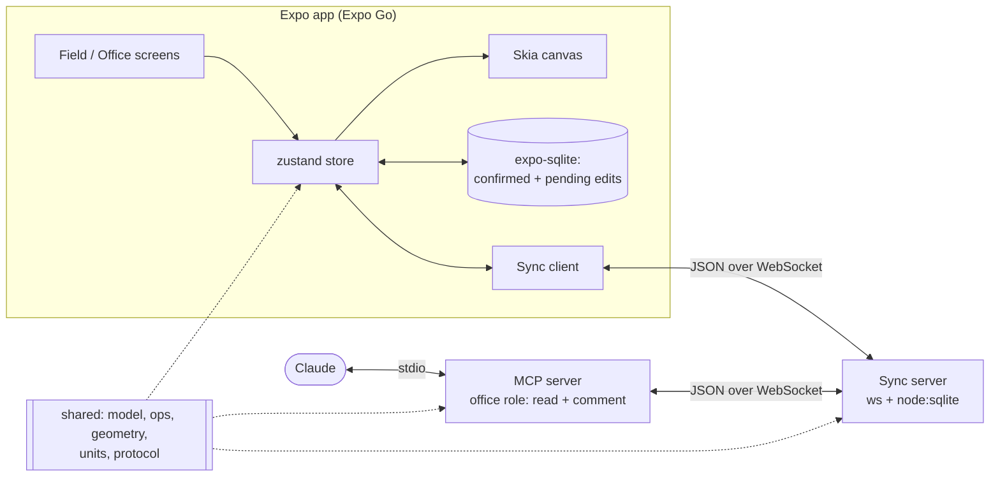

# Field Form

A field crew lead draws a space on a phone or tablet, marks its doors, windows, openings, steps and posts, and fills in the measurements from a (simulated) Bluetooth tape, a caliper or a keypad. An estimator in the office watches it arrive live on an iPad, with pan, zoom and tap-to-inspect, and can comment back.

It is an Expo app that runs in **Expo Go (SDK 58)**, with a small Node sync server you run yourself. There is no backend-as-a-service. Design decisions, packages and cuts are in [NOTES.md](NOTES.md).

## Quick start

**You need:** Node **22.13+** or **24.3+**, and **Expo Go for SDK 58** on two devices (phones, tablets or Android emulators). The devices and the computer must be on the same Wi-Fi network.

```sh
git clone https://github.com/dadavidtseng/field-form.git
cd field-form
npm install
npm run dev
```

`npm run dev` starts the sync server (port **8787**) and the Expo dev server together. When the QR code appears:

1. On each device, scan the QR code with Expo Go (Android) or the Camera app (iOS). On an Android emulator, press `a` in the terminal instead.
2. Choose **Field** on one device and **Office** on the other.
3. On the field device, tap **+ New space**. It appears on the office device straight away, and with **Follow field** on, the office device opens it automatically.

The app finds the sync server on its own: it uses the same computer that serves the app, and on an Android emulator it uses `10.0.2.2`.

## Try it

A five-minute walkthrough that touches every part:

| Step | Field device | Office device |
|---|---|---|
| 1 | Tap where the corners are. Tap the first corner again to **Close shape** (or **Done: open line** for a fence). | The outline appears when the shape is closed. Dashed walls are sketch estimates, marked `~`. |
| 2 | Press the big tape button. The reading fills the highlighted wall and moves on to the next one. Tap the next reading to edit what the simulated tape sends; **Type** opens a keypad (`12' 4-3/8"`, `3760 mm`). | Each wall turns solid and the shape re-flows to its true length. The changed element flashes. |
| 3 | Add a door, window, opening, step or post, then measure its width and its position. | Tap a wall or feature to see its value in ft-in and mm, how it was taken (tape, caliper, typed) and when. |
| 4 | — | Leave a comment on a wall, such as **Verify**. |
| 5 | The comment pin appears. Reply, or mark it resolved. | **Overview** shows perimeter, area, closure check, missing measurements and open comments. |
| 6 | Stop the sync server, keep measuring (the badge shows **Offline**), then start it again. | The office device catches up with every edit made while offline. |

For step 6, run the two halves in separate terminals, `npm run server` and `npm run start -w app`, so you can stop the server alone. Stop the server rather than turning off the device's Wi-Fi: Expo Go loads the app from your computer, so it can't run without the network.

## Commands

| Command | What it does |
|---|---|
| `npm run dev` | Sync server and Expo together (the usual way to run it) |
| `npm run server` | Sync server only, restarting on file changes |
| `npm test` | Unit tests for `shared`, `server` and `mcp` (Vitest) |
| `npm run typecheck` | TypeScript in every workspace |
| `npm run lint` / `npm run format` | ESLint / Prettier |

### Run the sync server in Docker (optional)

```sh
docker build -f server/Dockerfile -t field-form-server .
docker run -p 8787:8787 -v field-form-data:/data field-form-server
```

Then start only the app with `npm run start -w app`. Data stays in the `field-form-data` volume across restarts.

## Configuration

| Variable | Default | Use |
|---|---|---|
| `EXPO_PUBLIC_SYNC_URL` | detected | Point the app at a sync server on another machine, e.g. `ws://192.168.1.20:8787`. Set it before `npm run dev`. |
| `PORT` | `8787` | Sync server port |
| `DB_PATH` | `server/data/field-form.db` | Where the server keeps its SQLite op log |
| `FIELD_FORM_SYNC_URL` | `ws://localhost:8787` | Sync server the MCP server connects to |

To start with no data, stop the server and delete `server/data/field-form.db`. Then clear Expo Go's storage on each device, because the app keeps its own copy of every space.

## Troubleshooting

| Problem | Fix |
|---|---|
| The app shows **Offline** and never connects | The device and the computer must be on the same network. Allow Node through the firewall for port **8787** (Windows asks the first time; choose **Private networks**). The server prints the addresses devices can use when it starts. |
| Still offline on a guest or office network | Some networks block traffic between devices. Put the computer and the devices on a phone hotspot instead. |
| The server runs on a different computer | Set `EXPO_PUBLIC_SYNC_URL=ws://<that computer's IP>:8787`, then restart Expo with `npx expo start -c` from `app/` so the new value is bundled. |
| Expo Go says the project is incompatible | Update Expo Go: this project uses SDK 58. |
| `ExperimentalWarning: SQLite is an experimental feature` | Expected. The server uses Node's built-in `node:sqlite`, so there is no native module to compile. |
| `No such built-in module: node:sqlite`, or an `EBADENGINE` warning | Your Node is too old. Check `node -v`: you need 22.13+ or 24.3+. |

## How it works



- **One reducer on both sides.** Every change is an *op* (`wall.add`, `dimension.set`, `comment.add`, …). The app and the server apply ops with the same pure function, [`applyOp`](../shared/src/ops.ts), so they can't disagree about what an edit means. Undo sends the inverse op as a new edit.
- **Server-ordered log.** The server validates each op, gives it the next sequence number, saves it, and sends it to every device on that space, the author included. That copy is the author's acknowledgement.
- **Offline first.** The app applies an edit at once and keeps it as pending in SQLite until the server confirms it, so edits survive an app restart. On reconnect the server replays everything the device missed, then the device resends what is still pending. Ops are idempotent by ID, so nothing is applied twice.
- **The office can't change measurements.** The server rejects every op from the office role except comments. Rejections come back with a reason: `invalid`, `forbidden` or `conflict`.
- **Exact units.** Lengths are stored as integer micrometres, and feet-inches (to 1/16") or millimetres are only for display. The metric toggle never changes data.
- **Measurement sources.** The simulated tape and caliper implement one interface ([`tape.ts`](../shared/src/tape.ts)). A real Bluetooth device would need a development build, because Expo Go has no Bluetooth, but would plug in without UI changes.

## Repository layout

```
field-form/
  app/      Expo app (expo-router): screens, canvas, sync client
  server/   Node sync server: WebSocket + SQLite op log
  shared/   Pure TypeScript used by both: model, ops, geometry, units, protocol
  mcp/      MCP server so Claude can read spaces and comment
  docs/     This README and NOTES.md
```

The parts most likely to be subtly wrong have unit tests: unit parsing and formatting, wall geometry and closure, every op and its inverse, the sync state machine, and the server's replay and rejection rules.

## Claude integration (MCP)

The `mcp/` workspace lets Claude read every space and leave comments for the crew. It joins as an office client, so the server's rules apply: Claude can't change geometry or measurements.

| Tool | What it does |
|---|---|
| `list_spaces` | Every space, newest first, and whether a crew has it open |
| `get_space` | Perimeter, area, closure check, every wall and feature with how it was measured, what is still missing, ready-to-quote, comments |
| `add_comment` | Comment as the office on a wall, a feature or the whole space |
| `resolve_comment` | Resolve or reopen a comment |

**Claude Code** picks it up from [`.mcp.json`](../.mcp.json) when you start `claude` in the repository root (approve it once). To add it by hand:

```sh
claude mcp add field-form -- npx tsx mcp/src/index.ts
```

The sync server must be running. Then ask in plain words, e.g. *"What's still unmeasured in the kitchen?"*

## Known limits

- **iOS is untested.** Development and testing were on Android emulators (a phone and a tablet). Every package supports iOS.
- **No login.** The role is chosen on the first screen, and anyone who can reach the server can edit. Accounts with per-company spaces come before any real deployment.
- **Local network only.** A public deployment needs a hosted server with TLS (`wss://`).
- **Simulated devices.** Real Bluetooth tapes and calipers need a development build.
